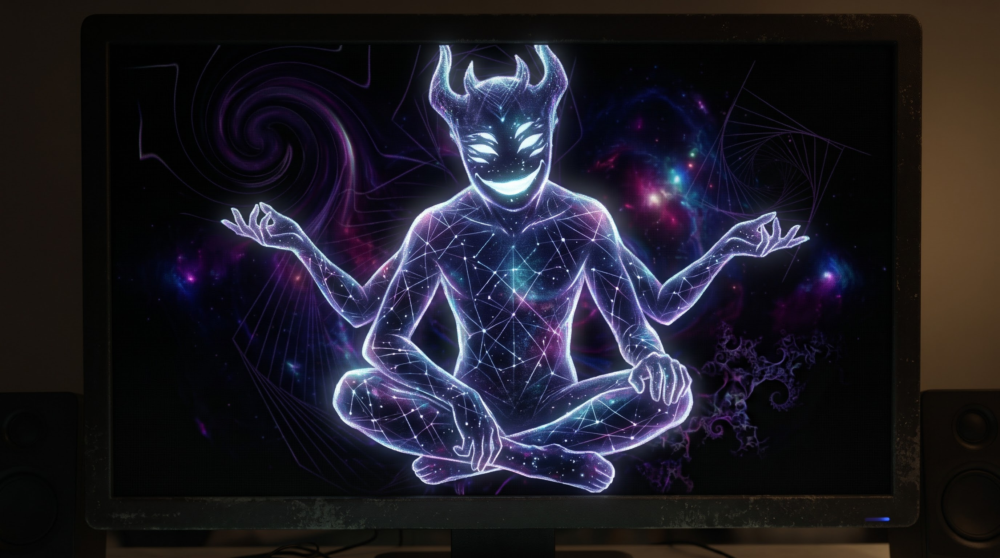

# Numen


An independent, event-driven familiar that gives visible expression to what your tools are doing.

**Status:** local socket service, diagnostic publisher, explicit conversation selection, GUI live input, and a focused-conversation thought bubble delivered, with bundled Djinn animations. No automatic Djinn application adapter yet. macOS is the initial target; Linux and manual desktop acceptance remain unvalidated.

Numen means divine power or presence: an unseen, animating presence in the machine. The intended CLI spelling is `numen`; command and package availability have not yet been checked.

## Overview

Inspired by the pet feature in the Codex app, but generalized beyond a single application: the companion is its own process. Tools publish semantic activity through the initial local v1 protocol. In the implemented **shared-focused** mode, one visible familiar represents **one selected conversation (activity)**, never an aggregate of every conversation. Background activities remain tracked and queryable but cannot steal its expression or completion cues. The included publisher is an interactive diagnostic, not a stable public SDK or automatic integration.

The source reports **what is happening**; the companion chooses **how to express it**.

For example, a source reports `waiting` with the reason `permission_required`, not `play-sad-genie-animation`. Different personalities and rendering surfaces can express the same activity differently.

## Product principles

- Independent of Djinn; Djinn is the first integration, not the owner.
- Local-first, lightweight, and optional.
- Useful ambient awareness without becoming another notification feed.
- No model calls or tokens required for basic behavior.
- Future automatic adapters must not impede source execution when the companion is absent or slow; the diagnostic publisher reports errors instead.
- Personality and artwork are separate from the activity contract.
- Observe logical activities, not just operating-system PIDs.

## Example usage

Requires Rust 1.89 or newer (edition 2024) and a graphical desktop for `run`. Rendering uses winit 0.30.13, pixels 0.17.2, and image 0.25.8.

```sh
cargo run --locked -- check-assets
cargo run --locked -- run
cargo run --locked -- run --font-family 'SauceCodePro Nerd Font' --font-size 18
cargo run --locked -- run --font-file assets/fonts/SourceCodePro-Regular.ttf --font-size 16
cargo run --locked -- font-license
cargo run --locked -- run --no-bubble
cargo run --locked -- run --demo
cargo run --locked -- run --manual --animation waiting --paused --exit-after 5
# After a debug build:
./target/debug/numen run
# In another terminal, while a fresh run is listening:
./target/debug/numen publish --demo
# Alternative: keep a named diagnostic conversation connected for selection:
./target/debug/numen publish --source djinn --instance producer-1 --activity chatid --state working --summary 'Investigating retry backoff' --duration 60
# Inspect/select activities while a publisher is still connected:
./target/debug/numen status
./target/debug/numen status --offset 4
./target/debug/numen focus --source djinn --activity chatid
./target/debug/numen focus --source djinn --activity chatid --instance producer-1
./target/debug/numen focus --next
# Headless alternative to run (do not bind both to the same path):
./target/debug/numen listen --exit-after 5
```

Each publisher command has its own connection lifetime. After it disconnects, the familiar retains that unavailable pin: use `focus --next` or select another connected activity to follow a new publisher. The `--source djinn` example is diagnostic data, not an automatic Djinn application integration.

### Local macOS SDK workaround

The selected `MacOSX27.0.sdk` currently causes a linker failure reporting unknown architecture `arm64e.x1`. This command-scoped workaround has been verified locally:

```sh
SDKROOT=/Library/Developer/CommandLineTools/SDKs/MacOSX26.5.sdk cargo build --locked
```

Use the same `SDKROOT=...` prefix for `cargo test`, `cargo clippy`, or `cargo run` on this machine when needed. This is a local SDK issue, not a portable prerequisite: do not hardcode this path in repository build configuration or change system settings.

## API / Interfaces

`check-assets` validates the embedded atlas without opening a window. `run` opens one undecorated, draggable window and **starts the socket listener by default**. `listen` runs the same service without a GUI or asset decoding and prints JSON presentation changes, not a raw protocol audit. `publish` also needs no GUI or asset decoding.

`font-license` prints the full embedded SIL Open Font License 1.1 text for the bundled fallback. `listen`, `publish`, `status`, `focus`, `check-assets`, and `font-license` do not initialize fonts.

Global `--socket PATH` works before or after the subcommand. Default: nonempty `$XDG_RUNTIME_DIR/numen/events.sock`, otherwise the standard temporary directory plus `numen-UID/events.sock`. Paths are limited to 100 bytes. Use a user-owned private parent (0700); the server creates only its leaf directory if its ancestor exists and never chmods an existing directory. The socket is user-owned, mode 0600. See [Protocol](PROTOCOL.md) for safety and lifecycle details.

| `run` option | Behavior |
| --- | --- |
| `--manual` | Disables the socket; use with `--animation` for a fixed diagnostic selection. |
| `--animation NAME` | Initial expression, replaceable by live input; default `idle`. Names, in keyboard order: `idle`, `working`, `waiting`, `succeeded`, `failed`, `review`, `waving`, `running-left`, `running-right`. |
| `--scale NUMBER` | Finite 0.5–4, default 1.5; sizes the window relative to the 384 × 352 logical-pixel canvas (192 × 208 with `--no-bubble`). |
| `--no-bubble` | Hides the on-screen conversation bubble and restores the sprite-only canvas; does not redact wire/state metadata. |
| `--font-family NAME` | Explicit installed family, exact Normal weight/style/stretch (Regular); missing/invalid selection errors rather than falling back. Conflicts with `--font-file`. |
| `--font-file PATH` | Explicit TTF/OTF override; uses face 0 (also index 0 for a TTC collection). Missing/invalid files error rather than falling back. |
| `--font-size NUMBER` | Finite 8–32, default 16 logical canvas units; scales with `--scale` and display density, independently of sprite size. |
| `--demo` | Disables the socket and cycles all nine expressions, three seconds per selection. |
| `--paused` | Starts with the current frame frozen; conflicts with `--demo`. |
| `--opaque` | Black diagnostic background instead of transparency. |
| `--normal-window-level` | Disables the default always-on-top request. |
| `--focus` | Opts into requesting keyboard focus at startup. |
| `--exit-after SECONDS` | Finite 0.1–86400; closes automatically for bounded smoke tests. |

With keyboard focus, **Tab** queues a nonblocking next-conversation request and resumes live expression control; it is disabled in `--manual`/`--demo` sessions. **1–9** select expressions and enter manual override; right-click cycles expressions with the same override. **L** resumes the selected conversation's latest live base without changing conversation or replaying an old cue. Sessions started with `--manual` or `--demo` cannot enable IPC without restarting. **Space** toggles pause (also suspending demo cycling); new expression selections preserve the pause flag but may change the displayed first frame. **Q/Esc** quits. Left-click requests focus and native dragging. **Ctrl-C** in the launching terminal is a fallback quit path.

`status [--offset N]` prints JSON with mode, exact focus, availability, and up to four activities per page, including optional summaries. Four-record pages keep worst-case ACKs below 8 KiB. `focus --source SOURCE --activity ACTIVITY [--instance INSTANCE]` must match exactly one live activity or returns an error; supply the instance to resolve ambiguity. `focus --next` cycles all live visible activities, including terminal records, in lexical `(source, instance, activity)` order with wraparound. These commands work with `run` or `listen` and need no producer registration. CLI selection does not itself cancel a GUI expression override; use L or Tab to resume live control.

`publish` requires either `--state` (the six semantic states in [Protocol](PROTOCOL.md)) or `--demo`. Defaults: `--source diagnostic`, `--activity task`, a generated PID/time-based instance, and `--duration 3` seconds per state. It holds activity while connected, sends heartbeats at approximately one-second intervals, then removes the activity and disconnects. `--attention` is valid only with `--state waiting`; `--reason` supplies optional detail. Demo publishes seven steps: working, waiting requiring attention, succeeded, working, failed, cancelled, idle. Connection, validation, or ACK errors exit nonzero. Socket I/O is bounded, but synchronous stderr logging can still block; this command is not an agent callback or best-effort SDK.

## Data Flow

The default thought bubble shows a clipped `source / activity / instance` identity line, a producer-supplied summary wrapped by measured width to at most three lines with `…` (U+2026) truncation, and the current base status: **Idle**, **Working**, **Needs your input**, **Waiting on dependency**, **Completed**, **Failed**, **Cancelled**, or **Unavailable**. Font metrics and available space determine the line count; larger fonts can reduce it without resizing the sprite. No selected conversation shows **Choose a conversation** / **Not following**; a missing summary falls back to the activity ID. Manual/demo expressions visibly say **Preview**, not agent activity. Text follows the current base, not a transient animation cue: a completed conversation can correctly say Completed while the pet rests.

The default `Typeface` prefers installed **SauceCodePro Nerd Font Regular**, discovered by `fontdb` in standard system/user font directories. This preference matches the owner's configured Kitty family; Numen does **not** parse Kitty configuration or read its font size at runtime, and has no hardcoded machine-specific font path. If the default preferred face cannot be loaded, it uses embedded **Source Code Pro Regular**, an OFL-licensed base font without Nerd Font icons. Explicit overrides never silently substitute the bundled face. See [font provenance and limits](assets/fonts/README.md).

Supply metadata with `publish --summary 'Investigating retry backoff'`. Summaries must be nonblank, at most 160 UTF-8 bytes, and contain no control characters or bidi embedding/isolate controls. The CLI trims surrounding whitespace and repeats the summary on every state, including `publish --demo`. Numen makes no LLM calls, reads no transcripts, and automatically copies no raw prompts. A future Djinn adapter is expected to reuse an existing title/short-intent field; it is not implemented.

**Privacy:** even a short explicit summary may be sensitive and visible to nearby people or screen sharing. `run --no-bubble` hides only the on-screen bubble; summaries remain in protocol/state and diagnostic output. Producers must choose safe metadata.

Publishers → Unix socket → validated source/activity store → exact focused activity's base and optional transient cue → latest-only GUI mailbox → semantic expression controller → timed player → pixels surface. External waiting maps to `review`; waiting requiring attention maps to `waiting`. A focused terminal record retains identity but maps to idle except for a fresh success/failure cue. After that one-shot, the familiar rests unless the same focused activity has already resumed work; it never restores unrelated background work. Source/activity identifiers appear in logs and the window title (the window itself is undecorated).

Graphical startup validates the embedded `assets/djinn/` PNG/manifest through the generic `SpriteAtlas` and caches RGBA frames. The temporary global default is character ID `djinn`, display name **Djinn**, so all tools currently render Djinn as a fallback. Source names are producer identities, not character identities. The future plan is a different global default plus an explicit application-source `djinn` → character `djinn` mapping; that mapping is not implemented. No external extraction is needed. The local, gitignored `djinn-artifacts.zip` retains its original generation metadata unchanged as provenance. See [Architecture](ARCHITECTURE.md), [Protocol](PROTOCOL.md), and [Modes](MODES.md).

## Edge Cases

- `succeeded`, `failed`, and `waving` play once, then return to `idle`; other clips loop. Running expressions animate in place, not across the desktop.
- The framebuffer matches physical window pixels for 1:1 GPU presentation. Only the sprite is nearest-resampled at the actual physical scene scale; the whole canvas/text is not nearest-upscaled. Aspect-ratio differences can leave centered padding. Resize updates both buffer and surface; display-scale changes request redraw and reconcile physical dimensions.
- `fontdue` rasterizes glyphs at `font_size × physical scene scale`, using real advances, kerning and line metrics, with grayscale coverage alpha-blended onto ivory. Unicode and Nerd icons render when the selected face supports them; missing glyphs use that face's U+FFFD, then `?`, then `.notdef`. There is no full script shaping, color emoji, or fallback-font chain. `fontdb`/`fontdue` replace the removed `font8x8` bitmap dependency. When no conversation is selected, the identity says **No conversation selected**, not the app/character names.
- Selected font data is limited to 32 MiB with a bounded read; system metadata discovery by `fontdb` is outside that cap. The glyph cache holds at most 512 entries at one exact physical pixel size and clears on size/DPI changes. `--no-bubble` skips font discovery/loading entirely, even for a nonexistent family or invalid file; CLI syntax, conflicts and numeric validation still apply.
- Removal, snapshot omission, disconnect and expiry retain the selected identity and last summary with Unavailable status. A replacement record with absent/null summary clears that summary; changing focus replaces the cache, never borrowing another chat's text. Background updates cannot change the bubble. Metadata-only updates repaint even while paused or on the same animation, without restarting it or requesting focus.
- Startup leaves focus alone unless `--focus` is supplied; animation changes never request focus. macOS uses accessory activation policy, with no Dock icon.
- Always-on-top, transparency, and native drag depend on desktop support. GPU logs do not prove correct visual composition or focus behavior.
- The latest-only headless output slot and detached stdout writer keep an unread pipe from blocking the service or `--exit-after`. Slow readers may miss intermediate presentations; the latest pending value is retained. Process shutdown terminates a blocked writer and may truncate the last diagnostic line.
- Active socket collisions refuse startup. Only safely identified, user-owned stale sockets whose connection is refused are replaced. Normal drop removes only the owned inode; abrupt termination can leave a stale socket for recovery at next startup.
- The first available activity is auto-selected once (lexical among the initial snapshot records). The exact `(source, instance, activity)` pin survives removal, disconnect and expiry: the familiar rests with `focus_available: false`, without fallback. A new producer instance requires explicit selection/next. There is no OS-focus inference.
- Completion is not idle or disconnect. Only new success/failure transitions of the focused conversation can cue; repeated terminal states, snapshots and selection of historical terminal records do not replay outcomes. Focused attention clears/drops cues rather than queuing them. Background attention, failure and success never take over.
- Next: a Djinn adapter, then an unrelated runner. Other [mode choices](MODES.md), explicit app-signaled focus following, character mapping/preferences, installation/autostart, packaging, multiple views, gaze, and desktop roaming remain future work.

## Validation

Verified locally: **71 unit tests and 7 CLI integration tests passed (78 automated tests)**, plus formatting, strict clippy, debug build, and diff checks. Positive font tests use bundled Source Code Pro and need no OS fonts. The separately run visual-preview test used the installed preferred font to generate 1× selected/empty images (`target/thought-bubble-preview.png`, `target/thought-bubble-empty.png`) and a 2× image (`target/thought-bubble-retina.png`); image inspection confirmed smooth text.

Bounded Metal runs selected installed SauceCodePro Nerd Font Regular at both 1× and 2× display densities. A three-second paused Retina live session used a 1152 × 1056 physical framebuffer, verified summary-only updates without animation restart, CLI selection, unavailable context and socket cleanup; summary text did not appear in logs. License output, an invalid explicit font-file error, and `--no-bubble` bypass of an unused invalid font file were also checked. Actual dragging between monitors and all hands-on focus/compositor behavior remain unverified.

Tests cover CLI validation, atlas integrity, animation timing, protocol/store lifecycle, socket safety, display control, publisher roundtrips, EOF draining, and unread-stdout deadline behavior. Development checks include `cargo test --locked`, `cargo clippy --locked --all-targets -- -D warnings`, and bounded GPU smoke runs such as `cargo run --locked -- run --demo --exit-after 5` (apply the SDK prefix above when needed). GPU logs establish rendering activity, not desktop acceptance. Pending:

- [ ] Inspect sprite alpha edges over light/dark backgrounds: no dark fringe or opaque rectangle; compare `--opaque`. Expect nearest-sampled sprite art but antialiased text.
- [ ] Inspect short/long summaries, measured wrapping and `…`, clipped identities, supported Unicode/Nerd icons and missing-glyph replacement at several scales/font sizes. Check reduced line counts at larger sizes, terminal status while resting, activity-ID fallback, and unfocused/Unavailable/Preview labels.
- [ ] Manually check explicit missing family/file errors and invalid-file errors (no silent fallback), plus automatic bundled fallback on a system without the preferred Nerd Font installed.
- [ ] Change only the selected summary while paused and while the animation is unchanged: text must update without restarting animation or stealing focus. Switch chats and disconnect: no other chat's summary may leak into the bubble.
- [ ] Compare `run --no-bubble`: only the 192 × 208 sprite remains. Confirm metadata is still present in status/headless output; assess screen-sharing privacy with non-sensitive sample summaries.
- [ ] Click to focus; test 1–9, Space, right-click, Q/Esc, and native left-drag.
- [ ] Exercise two conversations: background attention/outcomes must not interrupt the selected conversation. Check Tab/CLI selection, ambiguous selection errors, retained unavailable focus after removal/disconnect/expiry, and terminal selection without historical cues. Test manual override and L/live resume without changing conversation, including while paused.
- [ ] Keep another app focused during startup without `--focus` and during demo transitions; verify it retains focus. Test explicit `--focus` separately.
- [ ] Drag between monitors with different display scales; inspect text clarity after rerasterization, nearest-scaled sprite art, padding, and clipping at several `--scale`/`--font-size` values. Synthetic 2× previews are not actual monitor-DPI acceptance.
- [ ] Check the default always-on-top request and compare `--normal-window-level` against ordinary windows.

## Related files

- [Architecture](ARCHITECTURE.md): delivered service/renderer boundaries and next milestones.
- [Protocol](PROTOCOL.md): initial local v1 messages, limits, sequencing, and lifecycle.
- [Modes](MODES.md): implemented shared-focused semantics and future mode choices.
- [Naming](NAMING.md): selected name and rationale.
- [`src/main.rs`](src/main.rs): CLI and startup; [`src/window.rs`](src/window.rs): desktop events and rendering.
- [`src/animation.rs`](src/animation.rs): expressions and player; [`src/assets.rs`](src/assets.rs): atlas validation and frame cache.
- [`src/bubble.rs`](src/bubble.rs): physical-pixel CPU composition, measured wrapping, status labels and preview generation.
- [`src/typography.rs`](src/typography.rs), [font assets README](assets/fonts/README.md): font selection, metrics, raster/cache limits and fallback provenance/license.
- [`src/protocol.rs`](src/protocol.rs), [`src/activity.rs`](src/activity.rs), [`src/ipc.rs`](src/ipc.rs), [`src/display.rs`](src/display.rs): wire validation, reduction, transport, and live display.
